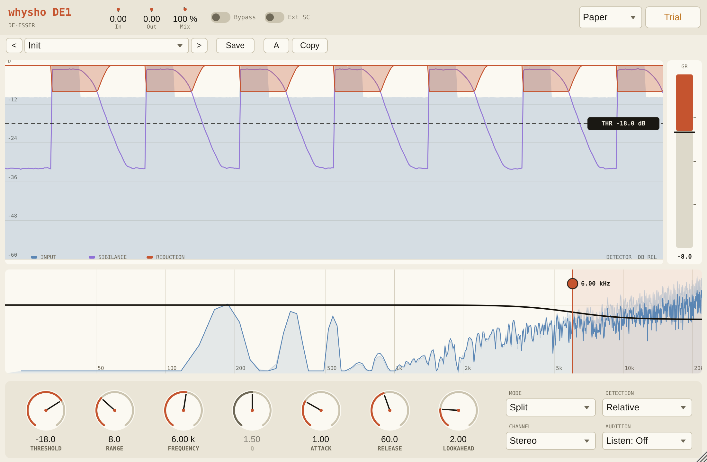

# whysho DE1

A modern, straightforward **de-esser** — part of the whysho suite, but fully independent.
Built on [JUCE](https://juce.com) (C++), shipping as **VST3** (Windows + macOS) and **AU** (macOS).
Same stack, theme system, licensing and installers as [whysho EQ1](https://github.com/whyshocom/whysho-eq1).

 



---

## Features

**De-essing**
- **Three modes** — **Split** (dynamic 2nd-order high shelf: only the highs above *Frequency*),
  **Bell** (dynamic bell around *Frequency*, width = *Q*), **Wide** (whole signal ducks)
- **Relative** detection (sibilance measured against the full-band level, so it keeps working when
  the singer gets louder/quieter) or classic **Absolute** dBFS detection
- Threshold · **Range** (max reduction) · Frequency 1–16 kHz · Q · Attack · Release
- **Lookahead** 0–10 ms (latency reported to the host) catches the start of every S
- **Stereo** (linked) · **Mid** · **Side** processing
- **Audition**: *Trigger* (hear what the detector hears) and *Delta* (hear only what's removed)
- **External sidechain** input — key the detector from another track
- In / Out gain, dry/wet **Mix**, latency-aligned **Bypass**

**Presets** — 21 factory presets in three banks + user presets saved to disk, prev/next, **A/B** + Copy
- *Vocals:* Gentle, Standard, Female/High, Male/Low, Rap Upfront, Aggressive, Breathy Pop,
  Bright & Airy, Narrow S Fix, Autotuned/Trap, Backing Vocal Stack, Podcast/Voice-Over, Whisper/ASMR
- *Instruments:* Hi-Hat Tamer, Cymbals/Overheads, Acoustic Guitar Pick, Strings/Brass Edge
- *Bus / Master:* Mix Bus De-Harsh, Master Gentle, Master Side Sibilance

**Interface**
- Scrolling **history display**: input, sibilance (detector) and gain reduction —
  **drag anywhere to set the threshold**, double-click to reset
- **Spectrum strip** with the shaded detection band and the **live reduction curve** —
  drag the handle to set the frequency, mouse-wheel for Q
- Gain-reduction meter with peak hold
- **Themes** — Paper (whysho brand, default), Midnight, Graphite — persisted with the project. Resizable UI

**Licensing** — see [`docs/LICENSING.md`](docs/LICENSING.md). Same system as EQ1: online activation →
machine-bound Ed25519-signed license verified offline, 14-day trial, layered anti-tamper.
DE1 uses the shared whysho license server (product id `whysho-de1`).

---

## Repository layout

```
CMakeLists.txt        Root build (fetches JUCE + Monocypher)
src/                  Plugin: DSP (dsp/), GUI (gui/), licensing (licensing/)
packaging/            Inno Setup (.exe) + macOS .pkg installer configs
.github/workflows/    CI: build + package + release on Win & macOS
tools/                Offscreen GUI snapshot renderer + headless DSP tests (dev only)
docs/                 Licensing notes, screenshots
```

## Building

**Requirements:** CMake ≥ 3.22, a C++17 compiler. First configure downloads JUCE 8 + Monocypher.

```bash
cmake -B build -DCMAKE_BUILD_TYPE=Release
cmake --build build --config Release
```

Artefacts land in `build/WhyshoDE1_artefacts/Release/` (`VST3/`, `AU/`, `Standalone/`).

**Tests** (headless DSP checks — reduction per mode, range/mix/bypass, latency alignment):
```bash
cmake -B build -DWHYSHO_BUILD_TESTS=ON && cmake --build build --target WhyshoDE1_DspTest
./build/WhyshoDE1_DspTest_artefacts/Release/WhyshoDE1_DspTest
```

**Installers** (CI builds these automatically; locally):
```bash
# Windows (needs Inno Setup):  powershell scripts/build-windows-installer.ps1
# macOS   (needs Xcode tools):  scripts/build-macos-installer.sh
```
Push a `v*` tag (e.g. `v0.1.0`) and CI publishes `WhyshoDE1-<version>-Windows.exe` and
`WhyshoDE1-<version>-macOS.pkg` to a GitHub Release — ready to upload to whysho.com.
Install locations and code-signing/notarization are documented in [`packaging/README.md`](packaging/README.md).

## Quick start

1. Put **whysho DE1** on the vocal. Start from a preset (e.g. *Vocal - Standard*).
2. Set **Audition → Trigger** and sweep **Frequency** until you hear mostly the S's. Back to *Off*.
3. Drag the **threshold line** down until the reduction (orange) only appears on the S's.
4. Use **Range** to limit how hard it can cut — 4–8 dB is natural, 10+ dB is obvious.
5. Check **Audition → Delta**: you should hear only sibilance, not words.

## Signal flow

```
input ─┬─────────────► lookahead delay ─► reduce (Wide / Split shelf / Bell) ─► mix ─► out
       │                                       ▲
       └─► (or ext. sidechain) ─► detection filter ─► envelope ─► rel/abs level ─► soft-knee
                                   (HP 24 dB/oct, or BP)                           gain computer
                                                                                  (6:1, 6 dB knee,
                                                                                   capped at Range)
```
